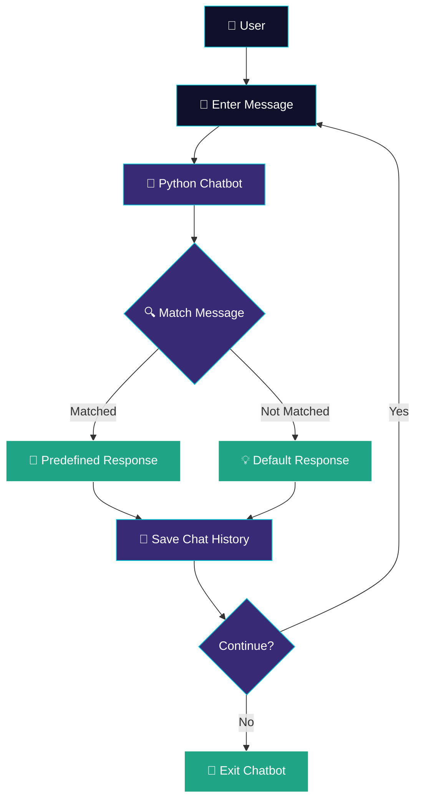

<div align="center">

# 🤖 PYTHON CHATBOT

### Smart Conversations | Simple Interaction | Python


**Developed by Saaqib Mohiddin**

</div>

---

## 🌌 PROJECT OVERVIEW

Python ChatBot is a simple rule-based conversational application developed using Python.

It accepts user messages, identifies predefined questions and provides suitable responses. It also stores conversation history in a text file.

## ✨ KEY FEATURES

| Feature | Description |
|---|---|
| 💬 Message Interaction | Responds to user messages |
| 🧠 Question Matching | Recognizes basic questions |
| 👋 Greetings | Responds to common greetings |
| 💾 Chat History | Saves conversation history |
| 📂 File Handling | Reads and writes chat records |
| 🔄 Continuous Interaction | Allows repeated conversations |

## 🛠️ TECHNOLOGIES USED

<div align="center">


</div>

| Technology | Purpose |
|---|---|
| Python | Main programming language |
| Loops | Maintains continuous chatbot interaction |
| Conditional Statements | Matches messages with predefined responses |
| File Handling | Saves and retrieves conversation history |

## 🎨 DESIGN THEME

### MIDNIGHT NAVY × ROYAL PURPLE × ELECTRIC CYAN

| Design Element | Colour | Hex Code |
|---|---|---|
| Primary | Midnight Navy | `#10102B` |
| Secondary | Royal Purple | `#392A75` |
| Accent | Electric Cyan | `#00C9D8` |
| Highlight | Success Teal | `#20A486` |
| Text | White | `#FFFFFF` |

**Design Identity:** Modern • Minimal • Technology • Conversational

## 📁 PROJECT STRUCTURE

```text
Python-ChatBot/
│
├── README.md
├── chatbot.py
├── index.html
└── chat_history.txt
```

## ⚙️ INSTALLATION & SETUP

### Requirements

- Python 3.x
- Visual Studio Code (recommended)

### Run the Project

**Step 1:** Open the project folder in VS Code.

**Step 2:** Open the terminal.

**Step 3:** Run the following command:

```bash
python chatbot.py
```

For Windows, you can also use:

```bash
py chatbot.py
```

**Step 4:** Enter messages and start chatting.

## 💬 SAMPLE QUESTIONS

Try these messages:

- hello
- how are you
- what is ai
- who created you
- good morning
- good night
- bye

## 🔄 HOW IT WORKS



## 🎯 PROJECT OBJECTIVE

The objective is to develop a simple and user-friendly chatbot using Python.

This project demonstrates:

- Python programming fundamentals.
- Loops and conditional statements.
- User input and output.
- Rule-based response matching.
- File handling and conversation storage.

## 🚀 FUTURE ENHANCEMENTS

- Add more predefined responses.
- Improve conversation handling.
- Develop a graphical user interface.
- Add database-based conversation storage.
- Explore Natural Language Processing (NLP).

---


<div align="center">

### COMPUTER SCIENCE & ENGINEERING
### ARTIFICIAL INTELLIGENCE

**Python Developer · Technology Enthusiast**

Building practical applications with Python and modern technologies.

<a href="https://github.com/saaqibmohiddin">
  
</a>

<br/>

<a href="https://github.com/saaqibmohiddin">

</a>

<br/><br/>


<br/><br/>


</div>


